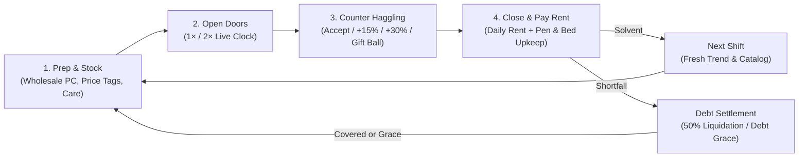
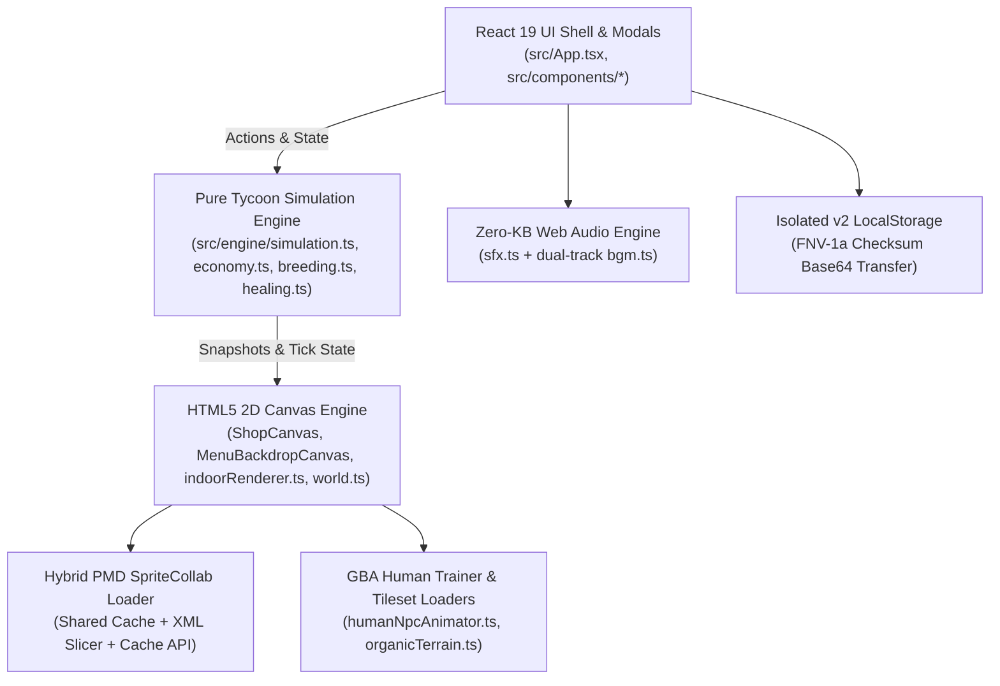

<div align="center">

<p>
  
  
  
  
  
  
  
</p>

# PokéMart: Low Cortisol Shift

**A Gen 4 DS / Pokémon Mystery Dungeon pixel-art pet shop, healing center, breeding & live counter-haggling tycoon for desktop web browsers.**

<p>
  
  
  
  
  
  
</p>

<p>
  <a href="#-gameplay-overview">Gameplay</a> •
  <a href="#-difficulty-modes">Difficulty Modes</a> •
  <a href="#-architecture--engineering-highlights">Architecture</a> •
  <a href="#-project-structure">Project Layout</a> •
  <a href="#-quick-start">Quick Start</a> •
  <a href="#-credits--attribution">Credits</a>
</p>

</div>

---

> [!NOTE]
> **Simple, Completely Free Fan Project (Entertainment Only):**
> **PokéMart: Low Cortisol Shift** is a simple, completely free, non-commercial fan-made web game built purely for entertainment purposes only—no ads, no paywalls, and no monetization. Pokémon and all related character names, designs, and IP belong to **Nintendo, Creatures Inc., and Game Freak**.

> [!TIP]
> **About the Title & Target Platform:**
> *"Low Cortisol Shift"* is solely the cozy visual/audio aesthetic—under the hood this is an **active Click-to-Manage tycoon simulator** with timed shifts, live counter haggling, daily rent & upkeep, Debt Grace, Emergency Liquidation, and Bankruptcy. Built exclusively for **PC desktop web browsers** (`1280×720` minimum; crisp integer pixel scaling optimized for `1920×1080` and `2560×1440+` widescreen displays with mouse & keyboard).

---

## ✨ Gameplay Overview

Step behind the royal-navy & oak counter of a pixel-art Gen 4 PokéMart. Stock display pens from **all 493 Gen 1–4 species (`#001 Bulbasaur` → `#493 Arceus`)**, rescue tired strays, breed compatible Egg Groups, hire extra counter clerks, and negotiate live deals before your shoppers run out of patience.



### Key Features

<table>
  <tr>
    <td width="50%" valign="top">
      <h4> Living Pixel-Art Store &amp; Organic Meadow</h4>
      <ul>
        <li><strong>Seamless Rolling Meadow Menu:</strong> Continuously scrolling Bayer-dithered pixel grass, winding dirt trails, wildflowers, and 12 grounded PMD Pokémon roaming behind the DS Title Hub.</li>
        <li><strong>Cohesive Gen 4 Indoor PokéMart:</strong> Solid paneled wainscoting, vertically aligned sunlit windows, a <strong>dynamic shift-countdown wall clock</strong> centered above the counter (freezes when paused/closed), recessed automatic sliding glass doors with split Poké Ball decals, grounded potted plants, and organic grass/dirt Display Pens with 2.5D front-fence Y-sorting.</li>
        <li><strong>Click-to-Manage Everything:</strong> Click Pokémon to inspect/evolve/feed, click queued shoppers (<code>!</code>) at the counter, or click the Wholesale PC, oak Upgrades Board, Resting Corner rug, and Egg Incubator pedestal directly on canvas.</li>
      </ul>
    </td>
    <td width="50%" valign="top">
      <h4> Shopkeepers, Trainers &amp; Live Haggling</h4>
      <ul>
        <li><strong>Selectable Staff &amp; Random Hiring:</strong> Choose your <strong>Initial Shopkeeper</strong> from 6 bundled clerks (<em>Leo, Clara, Liam, Penny, Hana, Steven</em>) when creating a profile, then purchase <strong>Hire Counter Clerk</strong> (<code>Lv.0→2</code>) to recruit up to 2 extra random clerks behind the counter—adding <code>+5s</code> base patience and slowing expiration by <strong>~33% / 50%</strong>.</li>
        <li><strong>6 Human Trainer Archetypes:</strong> 15 authentic Gen 3/4 Human Trainer shoppers with counter portraits, including everyday <strong>Normal Shoppers</strong> (~40% traffic; fair non-Legendary buyers) plus <em>Bargain Browsers</em>, <em>Cozy Collectors</em>, <em>Trend Fans</em>, <em>Shiny Seekers</em>, and <em>VIP Collectors</em> (the only buyers for Legendaries/Mythicals).</li>
        <li><strong>Zero Auto-Sales:</strong> Negotiate live at the non-blocking Counter Panel (<strong>Accept</strong>, <strong>Haggle +15%</strong>, <strong>Haggle +30%</strong>, <strong>Decline</strong>, + specialty Gift-Wrap Balls for tips &amp; XP).</li>
      </ul>
    </td>
  </tr>
  <tr>
    <td width="50%" valign="top">
      <h4> Rescue Care, Evolution &amp; Breeding</h4>
      <ul>
        <li><strong>Stray Healing Corner:</strong> Rescue discounted tired strays in Plush Nap Beds (<code>+5%/tick</code>, boosted by upgrades and care treats like <em>Moomoo Milk</em> &amp; <em>Oran Berries</em>).</li>
        <li><strong>493-Species Pokédex &amp; Evolutions:</strong> Track Normal &amp; Shiny discoveries across <code>#001–#493</code>; evolve companions via <strong>9 Evolution Stones</strong> + <strong>Rare Candy</strong>.</li>
        <li><strong>Egg Incubator Bench:</strong> Pair compatible Egg Groups (plus <strong>Ditto</strong> and <strong>Manaphy → Phione</strong>) to inherit stats and hunt <strong>3× value Shinies</strong>.</li>
      </ul>
    </td>
    <td width="50%" valign="top">
      <h4> Built-In Guide, Audio &amp; Isolated Saves</h4>
      <ul>
        <li><strong>Stylized Manager's Guide:</strong> Accessible from the top-right bar on both the Main Menu and In-Store HUD, explaining all loops, archetypes, formulas, upgrades, and stakes in 5 tabbed views.</li>
        <li><strong>Web Audio SFX &amp; Dual BGM:</strong> Zero-KB synthesized SFX plus polyphonic <em>Menu (~80 BPM)</em> and <em>Shop (~100 BPM)</em> chiptune tracks with 1-click mute toggles and volume mixer sliders.</li>
        <li><strong>Multi-Profile Local Storage:</strong> Isolated browser save slots auto-saving on every action + 15s interval, with FNV-1a checksum-verified UTF-8 Base64 Export/Import.</li>
      </ul>
    </td>
  </tr>
</table>

---

## 🎯 Difficulty Modes

Every Shift Manager profile chooses its own economy curve at creation:

| Mode | Starting Cash | Daily Rent (Scaling) | Pen / Bed Upkeep | Patience & Haggle | Debt Grace & Perks |
| :--- | :---: | :---: | :---: | :---: | :--- |
| **Relaxed** | `₽3,500` | `₽150` (`+₽25`/shift) | `₽30` / `₽20` | `145%` patience · `+14%` haggle | **1 Grace** · `0` walkout XP loss |
| **Standard** | `₽2,000` | `₽350` (`+₽60`/shift) | `₽55` / `₽35` | `100%` patience · `+0%` haggle | **1 Grace** · `-8` XP walkout penalty |
| **High Stakes** | `₽1,200` | `₽550` (`+₽95`/shift) | `₽85` / `₽50` | `72%` patience · `-12%` haggle | **0 Grace** · `+4%` Shiny bonus, **VIP Rk.4+ (`1.35×` payout)** |

---

## 🏗️ Architecture & Engineering Highlights

Designed as a **100% static, zero-backend TypeScript web app** with clean separation between pure simulation logic, procedural/sprite HTML5 Canvas rendering, and accessible React UI:



### Notable Technical Decisions
- **Hybrid Zero-404 PMD Sprite Pipeline (`src/canvas/pmdLoader.ts`, `pmdAnimator.ts`):**
  - Bundles 21 core species locally (`public/assets/pmd/`) for instant offline boot and embeds per-species availability from SpriteCollab `tracker.json` in `src/data/species.json` so unavailable sheets are **never requested (`0` 404s)**.
  - Shares a persistent singleton adapter across Main Menu & Indoor Store, preloads owned Pokémon `AnimData.xml` + PNG sheets **in parallel** on boot, persists remote fetches in the browser **Cache API** (`pokemart-pmd-v2`), measures exact opaque foot bounds (`measureSheetGroundMetrics`) so every species plants squarely on its contact shadow, and falls back gracefully to a pixel Poké Ball / portrait if a remote host drops.
- **Uniform Pixel Density & Desktop Widescreen Scaling (`src/canvas/layout.ts`, `indoorRenderer.ts`):**
  - Enforces `ctx.imageSmoothingEnabled = false` every frame and scales all 493 Pokémon at the room's integer art-pixel `unit` (`2px` @ `1280×800`, `3px` @ `1920×1080`, `4px` @ `2560×1440`) so small companions and towering Legendaries share identical crisp pixel thickness and authentic proportions.
  - Pre-renders static indoor architecture and horizontally periodic organic meadow strips into offscreen canvases for smooth 60 fps scrolling with exact mouse hit-testing (`hitTestIndoorScene`).
- **Clean Modularity & Zero Circular Dependencies:**
  - Verified via AST dependency analysis (`0` circular imports across `src/`), pure deterministic seeded RNG (`src/engine/rng.ts`) for reproducible tests, and native `<dialog>` modals (`CozyDialog.tsx`) with light-dismiss & focus accessibility.

### Tech Stack

| Layer | Technology |
| :--- | :--- |
| **Frontend** | React 19 · TypeScript 5.9 · Vite 8 · Tailwind CSS v4 (`@tailwindcss/vite`) |
| **Rendering** | Plain HTML5 2D Canvas (`imageSmoothingEnabled = false`) · PMD `AnimData.xml` 60 fps slicer · 4-dir Human overworld animator |
| **Typography** | Self-hosted **Chakra Petch** (`500/600/700` Latin + `₽` Latin-Ext) & **Silkscreen** (`400` headings/logo) WOFF2 (`SIL OFL 1.1`) |
| **Audio** | Pure browser **Web Audio API** chiptune SFX & dual-track polyphonic BGM sequencer (0 external audio files) |
| **Testing** | Vitest 4 + React Testing Library (`jsdom`) — **15 test suites, 59 passing tests** |
| **Deployment** | Static relative-path build (`base: './'`) with ready-to-run GitHub Pages workflow (`.github/workflows/deploy.yml`) |

---

## 📁 Project Structure

```text
PokeManager/
├── .github/workflows/deploy.yml       # Automated typecheck, test, build & GitHub Pages deploy
├── public/assets/
│   ├── fonts/                         # Self-hosted Chakra Petch, Pixelify Sans & Silkscreen WOFF2
│   ├── npcs/                          # 16 pret/pokeemerald Human overworlds + Showdown portraits
│   ├── tiles/                         # Decoded pret/pokeemerald tilesets & custom Pet Shop props
│   ├── pmd/                           # Bundled core 21 PMD species sheets (Walk/Idle/Sleep) & portraits
│   ├── items/                         # Curated Gen 4 pixel item icons
│   └── CREDITS.md                     # Attribution & non-commercial fan-project notice
├── scripts/
│   ├── build-pokedex.mjs              # Reproducibly generates 493-species catalog & core PMD bundle
│   └── fetch-world-assets.mjs         # Decodes pret/pokeemerald tiles, trainers & shop props
├── src/
│   ├── data/                          # 493 species JSON/TS, difficulties, Human NPCs, items, trends, upgrades
│   ├── engine/                        # Pure tycoon sim, haggling, rent, breeding, healing, storage, SFX & BGM
│   ├── canvas/                        # Indoor renderer, organic meadow backdrop, PMD & Human animators
│   └── components/                    # Main Menu, Top HUD, AudioControls, DS Dock, Counter & Guide modals
└── tests/                             # Engine, audio, canvas/PMD/Human animator & React UI suites (59 tests)
```

---

## 🚀 Quick Start

Requires **Node.js** (project targets Node `26.13.1`; works with modern Node 22+ LTS as well).

```bash
# 1. Install dependencies
npm install

# 2. Start local Vite dev server (http://localhost:5173)
npm run dev

# 3. Run full verification suite (typecheck, 59 unit/UI tests, production build)
npm run typecheck
npm test
npm run build

# 4. Preview production static bundle locally
npm run preview
```

<details>
<summary><strong>Optional Asset Regeneration &amp; GitHub Pages Notes</strong></summary>

- **Regenerate Pokédex / Core PMD Bundle:** `npm run build-pokedex`
- **Re-decode GBA Tilesets &amp; Human NPCs:** `npm run fetch-world-assets`
- **GitHub Pages Deployment:** `vite.config.ts` uses `base: './'` so all bundled assets resolve cleanly under nested repository URLs (`https://<user>.github.io/<repo>/`). Enable **Settings → Pages → Source: GitHub Actions** to publish automatically via [`.github/workflows/deploy.yml`](./.github/workflows/deploy.yml).

</details>

---

## 🙏 Credits & Attribution

All artwork, sprites, tilesets, fonts, and data credits—including **PMDCollab / SpriteCollab (`CC BY-NC 4.0`)**, **pret/pokeemerald**, **Pokémon Showdown**, **PokeAPI**, and self-hosted **SIL OFL 1.1** fonts—plus the non-commercial entertainment-only fan disclaimer are documented in full in [`public/assets/CREDITS.md`](./public/assets/CREDITS.md).
