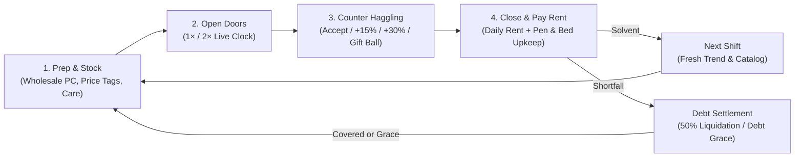
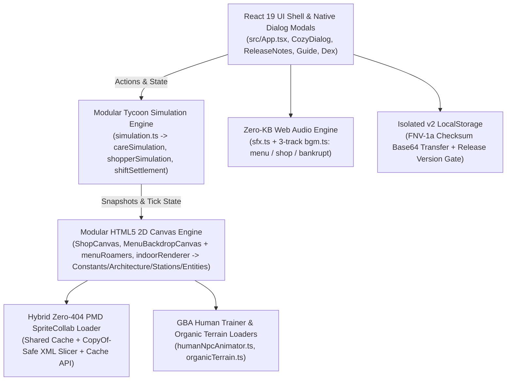

<div align="center">

<p>
  
  
  
  
  
  
  
</p>

# PokéMart: Low Cortisol Shift

**A Gen 4 DS / Pokémon Mystery Dungeon pixel-art pet shop, healing center, breeding & live counter-haggling tycoon for PC desktop web browsers.**

<p>
  
  
  
  
  
  
  
</p>

<p>
  <a href="#-gameplay-overview">Gameplay</a> •
  <a href="#-difficulty-modes">Difficulty Modes</a> •
  <a href="#-architecture--engineering-highlights">Architecture</a> •
  <a href="#-project-structure">Project Layout</a> •
  <a href="#-quick-start--deployment">Quick Start &amp; Deploy</a> •
  <a href="#-credits--attribution">Credits</a>
</p>

</div>

---

> [!WARNING]
> **Initial Playtest Release (`v0.1.0-playtest`):**
> **PokéMart: Low Cortisol Shift** is currently in its **Initial Playtest Release**. Features, game balance, UI, and mechanics **may be added, changed, or removed** as development continues. **Save Warning:** Your **trainer profiles and saved progress may be modified or deleted in future updates**—use *Save / Profiles → Export Save Code* if you want a backup, though save format revisions may still occur during playtesting.

> [!NOTE]
> **Simple, Completely Free Fan Project (Entertainment Only):**
> **PokéMart: Low Cortisol Shift** is a simple, completely free, non-commercial fan-made web game built strictly for entertainment purposes only—no ads, no paywalls, and no monetization. Pokémon and all related character names, designs, and IP belong to **Nintendo, Creatures Inc., and Game Freak**.

> [!TIP]
> **About the Title & Target Platform:**
> *"Low Cortisol Shift"* is solely the cozy visual/audio aesthetic—under the hood this is an **active Click-to-Manage tycoon simulator** with timed shifts, live counter haggling, daily rent & upkeep, Debt Grace, Emergency Liquidation, and Bankruptcy. Built exclusively for **PC desktop web browsers** (`1280×720` minimum; crisp integer pixel scaling optimized for `1920×1080` and `2560×1440+` widescreen displays with mouse & keyboard; mobile/phone viewports are intentionally unsupported).

---

## ✨ Gameplay Overview

Step behind the royal-navy & oak counter of a pixel-art Gen 4 PokéMart. Stock Display Pens from **all 493 Gen 1–4 species (`#001 Bulbasaur` → `#493 Arceus`)**, nurse tired strays in the Resting Corner, breed compatible Egg Groups, hire extra counter clerks, and negotiate live deals before shoppers run out of patience.



### Key Features

<table>
  <tr>
    <td width="50%" valign="top">
      <h4> Living Pixel-Art Store &amp; Randomized Meadow</h4>
      <ul>
        <li><strong>Randomized Left-to-Right Rolling Meadow Menu:</strong> Seamless Bayer-dithered grass, trails, wildflowers, and 12 grounded PMD Pokémon drawn randomly from the full 493-species Walk pool, trotting left-to-right across staggered lanes and re-rolling fresh species on wrap with zero pop-in.</li>
        <li><strong>Cohesive Gen 4 Indoor PokéMart:</strong> Solid wainscoting, vertically aligned sunlit windows, a <strong>centered dynamic shift-countdown wall clock</strong>, recessed automatic sliding glass doors with split Poké Ball decals, grounded potted plants, organic grass/dirt Display Pens with 2.5D front-fence Y-sorting, and a modular Resting Corner rug.</li>
        <li><strong>Click-to-Manage Floor &amp; Clean DS Modals:</strong> Click Pokémon, queued shoppers (<code>!</code>), Wholesale PC, oak Upgrades Board, Resting Corner, or Egg Incubator directly on canvas; every modal features pinned headers/filters and single-container DS-themed scrollbars.</li>
      </ul>
    </td>
    <td width="50%" valign="top">
      <h4> Shopkeepers, Trainers &amp; Live Haggling</h4>
      <ul>
        <li><strong>Selectable Staff &amp; Random Hiring:</strong> Choose your starting Shopkeeper from 6 bundled clerks (<em>Leo, Clara, Liam, Penny, Hana, Steven</em>), then upgrade <strong>Hire Counter Clerk</strong> (<code>Lv.0→2</code>) to recruit up to 2 extra random clerks behind the counter—adding <code>+5s</code> patience and slowing expiration by <strong>~33% / 50%</strong>.</li>
        <li><strong>6 Human Trainer Archetypes:</strong> 15 Gen 3/4 Human Trainer shoppers with counter portraits, including everyday <strong>Normal Shoppers</strong> (~40% traffic; fair non-Legendary buyers) plus <em>Bargain Browsers</em>, <em>Cozy Collectors</em>, <em>Trend Fans</em>, <em>Shiny Seekers</em>, and <em>VIP Collectors</em> (the sole buyers for Legendaries/Mythicals).</li>
        <li><strong>Zero Auto-Sales:</strong> Negotiate live at the non-blocking Counter Panel (<strong>Accept</strong>, <strong>Haggle +15%</strong>, <strong>Haggle +30%</strong>, <strong>Decline</strong>, + specialty Gift-Wrap Poké Balls for tips &amp; XP).</li>
      </ul>
    </td>
  </tr>
  <tr>
    <td width="50%" valign="top">
      <h4> Care, Evolution, Breeding &amp; Adoption Dex</h4>
      <ul>
        <li><strong>Display Pens, Reserve Kennel &amp; Resting Corner:</strong> Set global or per-pen price tags, swap companions between pens and the Reserve Kennel, and nurse discounted strays on Plush Nap Beds (<code>+5%/tick</code>, accelerated by upgrades &amp; care items).</li>
        <li><strong>493-Species Adoption Dex &amp; Evolutions:</strong> Search by name or <code>#ID</code>, filter by rarity or Legendaries &amp; Mythicals, track Normal/Shiny discoveries across <code>#001–#493</code>, and evolve companions via <strong>9 Evolution Stones</strong> + <strong>Rare Candy</strong>.</li>
        <li><strong>Egg Incubator Bench:</strong> Pair compatible Egg Groups (plus <strong>Ditto</strong> and <strong>Manaphy → Phione</strong>) to inherit stats and hunt <strong>3× value Shinies</strong>.</li>
      </ul>
    </td>
    <td width="50%" valign="top">
      <h4> Guide, Adaptive Audio, Patch Notes &amp; Saves</h4>
      <ul>
        <li><strong>Built-In Manager's Guide &amp; Release Notes:</strong> 5-tab interactive Guide accessible from Main Menu and Top HUD, plus a version-gated <strong>What's New / Patch Notes</strong> modal reopenable anytime from the Main Menu footer.</li>
        <li><strong>Consolidated Volume &amp; 3-Track Web Audio BGM:</strong> Zero-KB synthesized SFX plus polyphonic <em>Menu (~80 BPM)</em>, <em>Shop (~100 BPM)</em>, and bittersweet D-minor <em>Bankruptcy (~77 BPM)</em> tracks controlled from a single <strong>Volume</strong> popover (BGM/SFX mute toggles &amp; volume sliders persisted per profile).</li>
        <li><strong>Multi-Profile Local Storage:</strong> Isolated browser save slots auto-saving on every action + 15s interval, with FNV-1a checksum-verified UTF-8 Base64 Save Export/Import.</li>
      </ul>
    </td>
  </tr>
</table>

---

## 🎯 Difficulty Modes

Every Shift Manager profile chooses its own economy curve at creation:

| Mode | Starting Cash | Daily Rent (Scaling) | Pen / Bed Upkeep | Patience & Haggle | Debt Grace & Perks |
| :--- | :---: | :---: | :---: | :---: | :--- |
| **Relaxed** | `₽3,500` | `₽150` (`+₽25`/shift) | `₽30` / `₽20` | `145%` patience · `+14%` haggle | **1 Grace** · `0` walkout XP loss |
| **Standard** | `₽2,000` | `₽350` (`+₽60`/shift) | `₽55` / `₽35` | `100%` patience · `+0%` haggle | **1 Grace** · `-8` XP walkout penalty |
| **High Stakes** | `₽1,200` | `₽550` (`+₽95`/shift) | `₽85` / `₽50` | `72%` patience · `-12%` haggle | **0 Grace** · `+4%` Shiny bonus, **VIP Rk.4+ (`1.35×` payout)** |

---

## 🏗️ Architecture & Engineering Highlights

Designed as a **100% static, zero-backend TypeScript web app** with strictly one-way modular boundaries (`0` circular imports) separating simulation logic, HTML5 2D Canvas rendering, and accessible React UI:



### Notable Technical Decisions
- **Modular Canvas & Simulation Architecture:**
  - `src/canvas/indoorRenderer.ts` orchestrates 4 strictly one-way submodules (`indoorConstants.ts`, `indoorArchitecture.ts`, `indoorStations.ts`, `indoorEntities.ts`) while `MenuBackdropCanvas.tsx` delegates left-to-right randomized wildlife logic to `menuRoamers.ts`.
  - `src/engine/simulation.ts` orchestrates `careSimulation.ts`, `shopperSimulation.ts`, and `shiftSettlement.ts` over shared leaf helpers (`simulationHelpers.ts`) with deterministic seeded RNG (`rng.ts`) and **0 circular dependencies**.
- **Hybrid Zero-404 PMD Sprite Pipeline (`src/canvas/pmdLoader.ts`, `pmdAnimator.ts`):**
  - Bundles 21 core species locally (`public/assets/pmd/`) for instant offline boot, embeds SpriteCollab `tracker.json` availability in `src/data/species.json`, and resolves `AnimData.xml` `<CopyOf>` aliases before requesting secondary (`Idle`/`Sleep`) sheets—guaranteeing **0 HTTP 404 errors** across all 493 species.
  - Shares a persistent singleton adapter across Main Menu & Indoor Store, persists remote fetches in the browser **Cache API** (`pokemart-pmd-v2`), measures opaque foot bounds (`measureSheetGroundMetrics`) for snug pixel-oval contact shadows, and falls back cleanly if offline.
- **Uniform Pixel Density & Modern Accessible UI (`src/canvas/layout.ts`, `src/index.css`):**
  - Enforces `ctx.imageSmoothingEnabled = false` every frame at uniform integer art-pixel scaling (`2px` @ `1280×800`, `3px` @ `1920×1080`, `4px` @ `2560×1440`).
  - Uses native `<dialog>` modals (`CozyDialog.tsx`) with `overscroll-behavior: contain` scroll containment, single-container DS-themed scrollbars (`scrollbar-color`, `scrollbar-width: thin`, `scrollbar-gutter: stable`, `prefers-contrast: more`), native `popover="auto"` viewport-aware `Volume` dropdown, and accessible tablists with `hidden="until-found"` panels.

### Tech Stack

| Layer | Technology |
| :--- | :--- |
| **Frontend** | React 19 · TypeScript 5.9 · Vite 8 · Tailwind CSS v4 (`@tailwindcss/vite`) |
| **Rendering** | Plain HTML5 2D Canvas (`imageSmoothingEnabled = false`) · PMD `AnimData.xml` 60 fps slicer · 4-dir Human overworld animator |
| **Typography** | Self-hosted **Chakra Petch** (`500/600/700` Latin + `₽` Latin-Ext) & **Silkscreen** (`400` headings/logo) WOFF2 (`SIL OFL 1.1`) |
| **Audio** | Pure browser **Web Audio API** chiptune SFX & 3-track polyphonic BGM sequencer (`menu`, `shop`, `bankrupt`) |
| **Testing** | Vitest 4 + React Testing Library (`jsdom`) — **17 test suites, 68 passing tests** |
| **Deployment** | Static relative-path build (`base: './'`) ready for GitHub Pages (`.github/workflows/deploy.yml`) or Cloudflare Pages |

---

## 📁 Project Structure

```text
PokeManager/
├── .github/workflows/deploy.yml       # Automated typecheck, test, build & GitHub Pages deploy
├── public/assets/
│   ├── fonts/                         # Self-hosted Chakra Petch & Silkscreen WOFF2 fonts
│   ├── npcs/                          # 16 pret/pokeemerald Human overworlds + Showdown portraits
│   ├── tiles/                         # Decoded pret/pokeemerald tilesets & custom Pet Shop props
│   ├── pmd/                           # Bundled core 21 PMD species sheets (Walk/Idle/Sleep) & portraits
│   ├── items/                         # Curated Gen 4 pixel item icons
│   └── CREDITS.md                     # Attribution & non-commercial fan-project notice
├── scripts/
│   ├── build-pokedex.mjs              # Reproducibly generates 493-species catalog & core PMD bundle
│   └── fetch-world-assets.mjs         # Decodes pret/pokeemerald tiles, trainers & shop props
├── src/
│   ├── data/                          # 493 species JSON/TS, difficulties, NPCs, items, trends, upgrades, releaseNotes
│   ├── engine/
│   │   ├── simulation.ts              # Orchestrator (createInitialGameState, advanceShiftTick)
│   │   ├── careSimulation.ts          # Wholesale/items/upgrades, pens/kennel, healing & breeding
│   │   ├── shopperSimulation.ts       # Shopper spawning, browsing, counter queue, clerk patience & haggling
│   │   ├── shiftSettlement.ts         # Open/pause shift, emergency liquidation, rent, debt grace & rollover
│   │   ├── simulationHelpers.ts       # Leaf types (SfxCue, ActionResult, TickResult) & RNG/log helpers
│   │   └── bgm.ts / sfx.ts / storage.ts / economy.ts / breeding.ts / healing.ts / items.ts / dex.ts / catalog.ts
│   ├── canvas/
│   │   ├── indoorRenderer.ts          # Layered 2.5D Y-sorted indoor orchestrator
│   │   ├── indoorConstants.ts         # Shared indoor palettes, bitmaps, consolidated BALL_COLORS & primitives
│   │   ├── indoorArchitecture.ts      # Floor tiling, wall, sunlit windows, dynamic wall clock & sliding doors
│   │   ├── indoorStations.ts          # Counter, display pens, Resting Corner alcove, PC kiosk & incubator
│   │   ├── indoorEntities.ts          # Shopkeepers, grounded Pokémon, shoppers, bubbles, particles & hover
│   │   ├── MenuBackdropCanvas.tsx     # Seamless rolling organic meadow canvas
│   │   ├── menuRoamers.ts             # Randomized left-to-right 493-species meadow roamer engine
│   │   └── ShopCanvas.tsx / world.ts / layout.ts / organicTerrain.ts / pmdLoader.ts / pmdAnimator.ts / humanNpcAnimator.ts
│   └── components/                    # Main Menu, Top HUD, AudioControls, DS Dock, Counter, Guide, ReleaseNotes & modals
└── tests/                             # Engine, audio, canvas/roamer/PMD/Human & React UI suites (68 tests)
```

---

## 🚀 Quick Start & Deployment

Requires **Node.js** (project targets Node `26.13.1`; works cleanly on modern Node 22+ LTS as well).

```bash
# 1. Install dependencies
npm install

# 2. Start local Vite dev server (http://localhost:5173)
npm run dev

# 3. Run full verification suite (typecheck, 68 unit/UI tests, production build)
npm run typecheck
npm test
npm run build

# 4. Preview production static bundle locally (http://localhost:4173)
npm run preview
```

### Static Hosting (GitHub Pages / Cloudflare Pages)
- **`base: './'` Static Build:** All bundled JS/CSS chunks and `./assets/...` sprites, tilesets, icons, and fonts resolve relatively so the `dist/` output works seamlessly at root domains and nested repository subpaths (`https://<user>.github.io/<repo>/`).
- **GitHub Pages:** Enable **Settings → Pages → Source: GitHub Actions** to publish automatically via [`.github/workflows/deploy.yml`](./.github/workflows/deploy.yml) (runs `npm ci`, `npm run typecheck`, `npm test`, `npm run build`, and deploys `dist/`).
- **Cloudflare Pages / Static Hosts:** Set build command to `npm run build` and publish directory to `dist`.

<details>
<summary><strong>Optional Asset Regeneration Scripts</strong></summary>

- **Regenerate Pokédex / Core PMD Bundle:** `npm run build-pokedex`
- **Re-decode GBA Tilesets &amp; Human NPCs:** `npm run fetch-world-assets`

</details>

---

## 🙏 Credits & Attribution

All artwork, sprites, tilesets, fonts, and data credits—including **PMDCollab / SpriteCollab (`CC BY-NC 4.0`)**, **pret/pokeemerald**, **Pokémon Showdown**, **PokeAPI**, and self-hosted **SIL OFL 1.1** fonts—plus the non-commercial entertainment-only fan disclaimer are documented in full in [`public/assets/CREDITS.md`](./public/assets/CREDITS.md).
